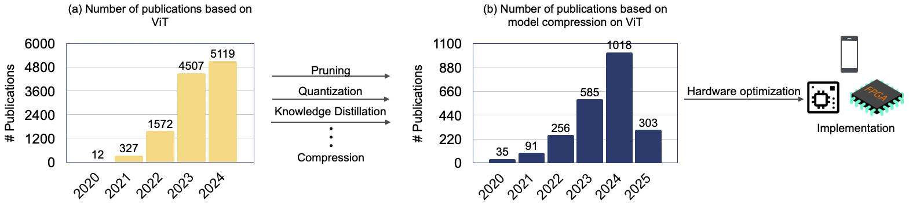
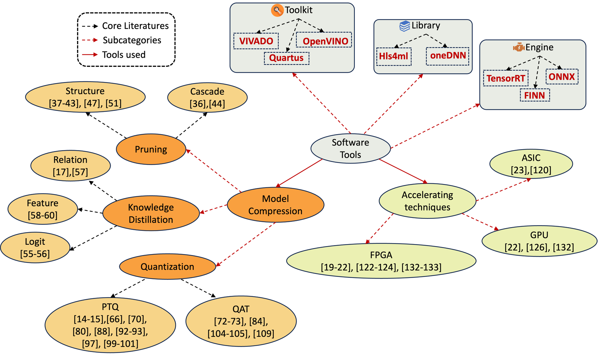
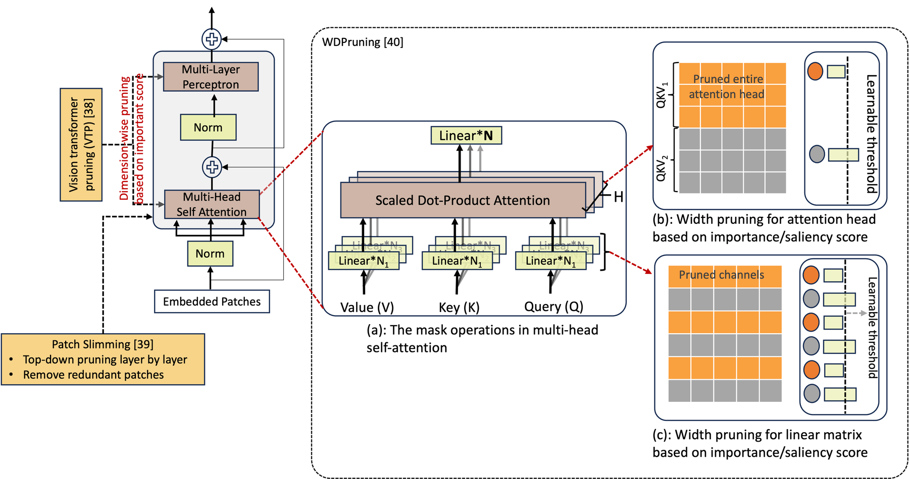
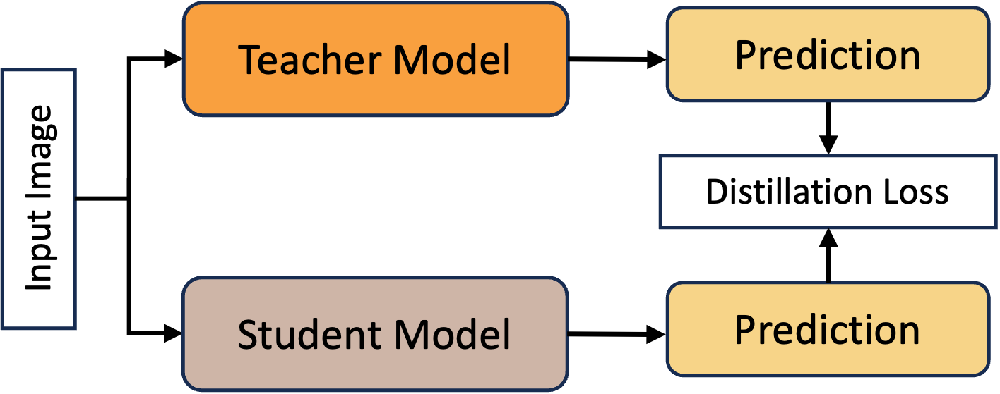
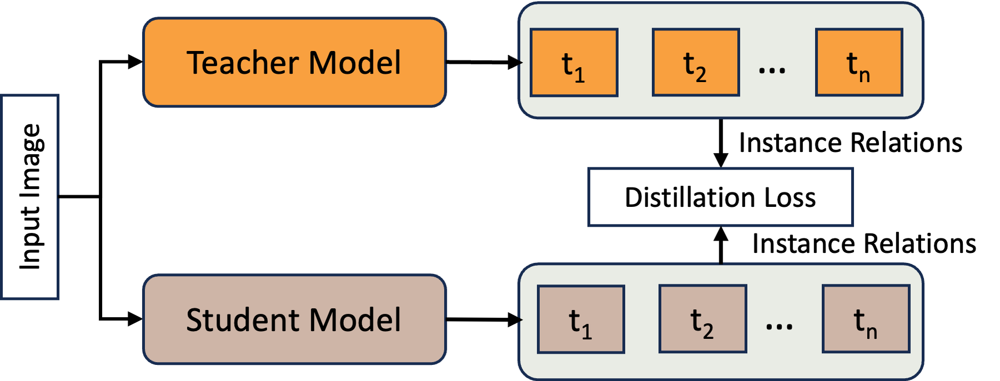
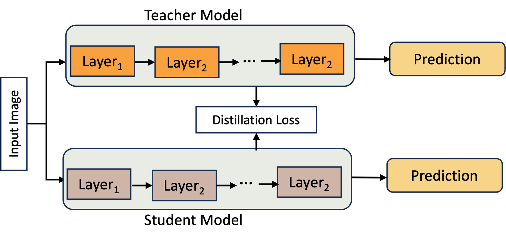
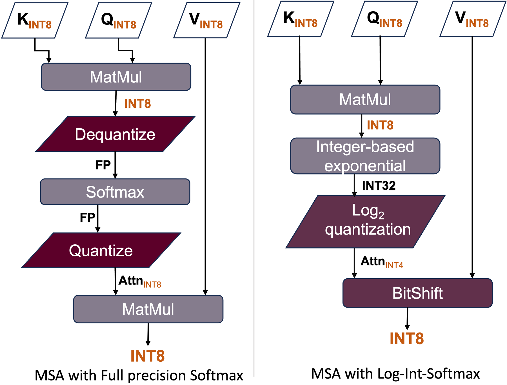
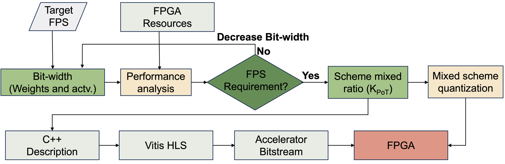

# Vision Transformers on the Edge: A Comprehensive Survey of Model Compression and Acceleration Strategies

[](https://arxiv.org/abs/2503.02891)
[](https://www.sciencedirect.com/science/article/abs/pii/S0925231225010896)


**Shaibal Saha, Lanyu Xu** · Oakland University, Rochester Hills, MI

A curated list of the papers reviewed in our survey on deploying Vision Transformers (ViTs) on resource-constrained edge devices. The survey covers **model compression** (pruning, knowledge distillation, quantization), **software tools** for edge inference, and **hardware acceleration** strategies across GPUs, FPGAs, and ASICs.

<p align="center">
  
  <br><em>Publication trends for ViTs and for ViT compression, motivating hardware-aware deployment.</em>
</p>

## 📑 Contents

- [Survey Overview](#-survey-overview)
- [Model Compression](#-model-compression)
  - [Pruning](#pruning)
  - [Knowledge Distillation](#knowledge-distillation)
  - [Quantization](#quantization)
- [Software Tools for Edge Deployment](#-software-tools-for-edge-deployment)
- [Hardware Acceleration](#-hardware-acceleration)
  - [Integer Approximations for Non-linear Operations](#integer-approximations-for-non-linear-operations)
  - [SW-HW Co-design](#sw-hw-co-design)
  - [Pure Hardware Accelerators](#pure-hardware-accelerators)
  - [Other Techniques](#other-techniques)
- [Related Surveys](#-related-surveys)
- [Citation](#-citation)

## 🗺️ Survey Overview

<p align="center">
  
  <br><em>Taxonomy of the survey: model compression, accelerating techniques, and the software toolchain.</em>
</p>

---

## 🗜️ Model Compression

### Pruning

<p align="center">
  
  <br><em>Importance-based pruning for ViTs (VTP, WDPruning, Patch Slimming).</em>
</p>

| Method | Title | Venue | Year | Type |
|:--|:--|:--:|:--:|:--|
| **VTP** | Vision Transformer Pruning | arXiv | 2021 | Importance-based |
| **S²ViTE** | Chasing Sparsity in Vision Transformers: An End-to-End Exploration | NeurIPS | 2021 | Structured |
| **Patch Slimming** | Patch Slimming for Efficient Vision Transformers | CVPR | 2022 | Importance / Token |
| **WDPruning** | Width & Depth Pruning for Vision Transformers | AAAI | 2022 | Importance / Structured |
| **UVC** | Unified Visual Transformer Compression | ICLR | 2022 | Structured |
| **SPViT** | SPViT: Enabling Faster Vision Transformers via Latency-aware Soft Token Pruning | ECCV | 2022 | Token |
| **CP-ViT** | CP-ViT: Cascade Vision Transformer Pruning via Progressive Sparsity Prediction | arXiv | 2022 | Cascade |
| **VTC-LFC** | VTC-LFC: Vision Transformer Compression with Low-Frequency Components | NeurIPS | 2022 | Cascade |
| **SAViT** | SAViT: Structure-Aware Vision Transformer Pruning via Collaborative Optimization | NeurIPS | 2022 | Structured |
| **MD** | Multi-Dimensional Vision Transformer Compression via Dependency Guided Gaussian Process Search | CVPR | 2022 | Structured |
| **Learned Runtime Pruning** | Accelerating Attention through Gradient-Based Learned Runtime Pruning | ISCA | 2022 | Dynamic |
| **NViT** | Global Vision Transformer Pruning with Hessian-Aware Saliency | CVPR | 2023 | Structured |
| **Dynamic Token Pruning** | Dynamic Token Pruning in Plain Vision Transformers for Semantic Segmentation | ICCV | 2023 | Token |
| **LPViT** | LPViT: Low-Power Semi-structured Pruning for Vision Transformers | ECCV | 2024 | Semi-structured |
| **Background-aware Token Pruning** | Token Pruning using a Lightweight Background Aware Vision Transformer | NeurIPS Workshop | 2024 | Token |

### Knowledge Distillation

<p align="center">
  
  
  
  <br><em>Three families of KD for ViTs: logit-based, relation-based, and feature-based.</em>
</p>

| Method | Title | Venue | Year | Type |
|:--|:--|:--:|:--:|:--|
| **DeiT** | Training Data-Efficient Image Transformers & Distillation through Attention | ICML | 2021 | Logit |
| **TinyViT** | TinyViT: Fast Pretraining Distillation for Small Vision Transformers | ECCV | 2022 | Logit |
| **DearKD** | DearKD: Data-Efficient Early Knowledge Distillation for Vision Transformers | CVPR | 2022 | Logit |
| **Manifold Distillation** | Learning Efficient Vision Transformers via Fine-Grained Manifold Distillation | NeurIPS | 2022 | Feature |
| **MiniViT** | MiniViT: Compressing Vision Transformers with Weight Multiplexing | CVPR | 2022 | Feature |
| **AProbe** | Attention Probe: Vision Transformer Distillation in the Wild | ICASSP | 2022 | Feature |
| **TAT** | Knowledge Distillation via the Target-aware Transformer | CVPR | 2022 | Relation |
| **Co-advise** | Co-advise: Cross Inductive Bias Distillation | CVPR | 2022 | Relation |

### Quantization

<p align="center">
  
  <br><em>Full-precision Softmax vs. integer-only Log-Int-Softmax in a quantized MSA block (FQ-ViT).</em>
</p>

#### Post-Training Quantization (PTQ)

| Method | Title | Venue | Year | Category |
|:--|:--|:--:|:--:|:--|
| **PTQ-ViT** | Post-Training Quantization for Vision Transformer | NeurIPS | 2021 | Mixed-precision |
| **PTQ4ViT** | PTQ4ViT: Post-Training Quantization for Vision Transformers with Twin Uniform Quantization | ECCV | 2022 | Statistic-based |
| **APQ-ViT** | Towards Accurate Post-Training Quantization for Vision Transformer | ACM MM | 2022 | Statistic-based |
| **FQ-ViT** | FQ-ViT: Post-Training Quantization for Fully Quantized Vision Transformer | IJCAI | 2022 | Integer-only |
| **NoisyQuant** | NoisyQuant: Noisy Bias-Enhanced Post-Training Activation Quantization for Vision Transformers | CVPR | 2023 | Statistic-based |
| **I-ViT** | I-ViT: Integer-only Quantization for Efficient Vision Transformer Inference | ICCV | 2023 | Integer-only |
| **RepQ-ViT** | RepQ-ViT: Scale Reparameterization for Post-Training Quantization of Vision Transformers | ICCV | 2023 | Integer-only |
| **TSPTQ-ViT** | TSPTQ-ViT: Two-Scaled Post-Training Quantization for Vision Transformer | ICASSP | 2023 | Statistic-based |
| **MPTQ-ViT** | MPTQ-ViT: Mixed-Precision Post-Training Quantization for Vision Transformer | arXiv | 2024 | Mixed-precision |
| **LRP-QViT** | LRP-QViT: Mixed-Precision Vision Transformer Quantization via Layer-wise Relevance Propagation | arXiv | 2024 | Mixed-precision |
| **ERQ** | ERQ: Error Reduction for Post-Training Quantization of Vision Transformers | ICML | 2024 | Mixed-precision |
| **AdaLog** | AdaLog: Post-Training Quantization for Vision Transformers with Adaptive Logarithm Quantizer | ECCV | 2024 | Learning-based |
| **CLAMP-ViT** | CLAMP-ViT: Contrastive Data-Free Learning for Adaptive Post-Training Quantization of ViTs | ECCV | 2024 | Learning-based |

#### Quantization-Aware Training (QAT)

| Method | Title | Venue | Year | Category |
|:--|:--|:--:|:--:|:--|
| **Q-ViT** | Q-ViT: Accurate and Fully Quantized Low-bit Vision Transformer | NeurIPS | 2022 | KD-based |
| **Q-DETR** | Q-DETR: An Efficient Low-Bit Quantized Detection Transformer | CVPR | 2023 | KD-based |
| **PSAQ-ViT V2** | PSAQ-ViT V2: Toward Accurate and General Data-Free Quantization for Vision Transformers | TNNLS | 2023 | KD-based, data-free |
| **AQ-DETR** | AQ-DETR: Low-Bit Quantized Detection Transformer with Auxiliary Queries | AAAI | 2024 | KD-based |
| **Quantformer** | Quantformer: Learning Extremely Low-Precision Vision Transformers | TPAMI | 2023 | Standalone |
| **PackQViT** | PackQViT: Faster Sub-8-bit Vision Transformers via Full and Packed Quantization on the Mobile | NeurIPS | 2023 | Standalone |
| **QD-BEV** | QD-BEV: Quantization-aware View-guided Distillation for Multi-view 3D Object Detection | ICCV | 2023 | Standalone |

---

## 🧰 Software Tools for Edge Deployment

| Tool | Type | Target Hardware |
|:--|:--|:--|
| [Xilinx Vivado Design Suite](https://www.amd.com/en/products/software/adaptive-socs-and-fpgas/vivado.html) | Toolkit | Xilinx FPGA |
| [Intel Quartus Prime](https://www.intel.com/content/www/us/en/products/details/fpga/development-tools/quartus-prime.html) | Toolkit | Intel FPGA |
| [OpenVINO](https://github.com/openvinotoolkit/openvino) | Toolkit | Intel FPGA, GPU, CPU |
| [Vitis AI](https://www.xilinx.com/products/design-tools/vitis/vitis-ai.html) | Engine | Xilinx FPGA |
| [FINN](https://xilinx.github.io/finn/) | Engine | Xilinx FPGA |
| [TensorRT](https://developer.nvidia.com/tensorrt) | Engine | NVIDIA GPU |
| [ONNX Runtime](https://onnxruntime.ai/) | Engine | FPGA, GPU, CPU |
| [hls4ml](https://fastmachinelearning.org/hls4ml/index.html) | Library | FPGA |
| [oneDNN](https://github.com/oneapi-src/oneDNN) | Library | Intel CPU, ARM (GPU experimental) |
| [NVIDIA Triton Inference Server](https://github.com/triton-inference-server/server) | Inference Server | NVIDIA GPU, x86, ARM |

---

## ⚡ Hardware Acceleration

<p align="center">
  
  <br><em>An FPGA-aware SW-HW co-design flow (Auto-ViT-Acc): bit-width is lowered until the target FPS is met, then synthesized to an accelerator bitstream.</em>
</p>

### Integer Approximations for Non-linear Operations

| Method | Title | Venue | Year | Hardware |
|:--|:--|:--:|:--:|:--|
| **Softermax** | Softermax: Hardware/Software Co-Design of an Efficient Softmax for Transformers | DAC | 2021 | — |
| **EdgeKernel** | Practical Edge Kernels for Integer-Only Vision Transformers under Post-Training Quantization | MLSys | 2023 | Apple A13 / M1 |
| **SOLE** | SOLE: Hardware-Software Co-design of Softmax and LayerNorm for Efficient Transformer Inference | ICCAD | 2023 | ASIC (28 nm) |
| **SwiftTron** | SwiftTron: An Efficient Hardware Accelerator for Quantized Transformers | IJCNN | 2023 | ASIC (65 nm) |

*FQ-ViT, I-ViT, and PackQViT (listed under Quantization) also provide integer-only Softmax, GELU, and LayerNorm.*

### SW-HW Co-design

| Method | Title | Venue | Year | Hardware |
|:--|:--|:--:|:--:|:--|
| **VAQF** | VAQF: Fully Automatic Software-Hardware Co-Design Framework for Low-Bit Vision Transformer | arXiv | 2022 | FPGA (ZCU102) |
| **Auto-ViT-Acc** | Auto-ViT-Acc: An FPGA-Aware Automatic Acceleration Framework for Vision Transformer with Mixed-Scheme Quantization | FPL | 2022 | FPGA (ZCU102) |
| **M³ViT** | M³ViT: Mixture-of-Experts Vision Transformer for Efficient Multi-task Learning with Model-Accelerator Co-design | NeurIPS | 2022 | FPGA (ZCU102/104) |
| **HeatViT** | HeatViT: Hardware-Efficient Adaptive Token Pruning for Vision Transformers | HPCA | 2023 | FPGA (ZCU102) |
| **ViTCoD** | ViTCoD: Vision Transformer Acceleration via Dedicated Algorithm and Accelerator Co-Design | HPCA | 2023 | ASIC (28 nm) |
| **EQ-ViT** | EQ-ViT: Algorithm-Hardware Co-Design for End-to-End Acceleration of Real-Time Vision Transformer Inference on Versal ACAP Architecture | TCAD | 2024 | ACAP (VCK190) |
| **PIVOT** | PIVOT: Input-aware Path Selection for Energy-efficient ViT Inference | DAC | 2024 | GPP-compatible |

### Pure Hardware Accelerators

| Method | Title | Venue | Year | Hardware |
|:--|:--|:--:|:--:|:--|
| **ViA** | ViA: A Novel Vision-Transformer Accelerator Based on FPGA | TCAD | 2022 | FPGA (Alveo U50) |
| **ViTA** | ViTA: A Vision Transformer Inference Accelerator for Edge Applications | ISCAS | 2023 | FPGA (Zynq ZC7020) |
| **ME-ViT** | ME-ViT: A Single-Load Memory-Efficient FPGA Accelerator for Vision Transformers | HiPC | 2023 | FPGA (U200) |
| **Weight-Loop Dataflow** | A 109-GOPs/W FPGA-based Vision Transformer Accelerator with Weight-Loop Dataflow Featuring Data Reusing and Resource Saving | TCSVT | 2024 | FPGA (XCZU9EG) |
| **COSA Plus** | COSA Plus: Enhanced Co-Operative Systolic Arrays for Attention Mechanism in Transformers | TCAD | 2025 | FPGA (XCVU13P) |

### Other Techniques

| Method | Title | Venue | Year | Hardware |
|:--|:--|:--:|:--:|:--|
| **ED-ViT** | ED-ViT: Splitting Vision Transformer for Distributed Inference on Edge Devices | arXiv | 2024 | Raspberry Pi 4B cluster |

---

## 📚 Related Surveys

| Title | Venue | Year |
|:--|:--:|:--:|
| Lightweight and Optimization Acceleration Methods for Vision Transformer: A Review | ITSC | 2022 |
| Hardware-friendly Compression and Hardware Acceleration for Transformer: A Survey | Electronic Research Archive | 2022 |
| A Survey on Efficient Vision Transformers: Algorithms, Techniques, and Performance Benchmarking | TPAMI | 2024 |
| Model Quantization and Hardware Acceleration for Vision Transformers: A Comprehensive Survey | arXiv | 2024 |

---

## 📖 Citation

If you find this survey or list useful, please cite:

```bibtex
@article{saha2025vision,
  title   = {Vision Transformers on the Edge: A Comprehensive Survey of Model Compression and Acceleration Strategies},
  author  = {Saha, Shaibal and Xu, Lanyu},
  journal = {Neurocomputing},
  year    = {2025},
  url     = {https://www.sciencedirect.com/science/article/pii/S0925231225010896},
  note    = {arXiv:2503.02891}
}
```

## 🙏 Acknowledgement

This work was partly supported by the U.S. National Science Foundation under Grant CNS-2245729 and the Michigan Space Grant Consortium 80NSSC20M0124.

## 🤝 Contributing

Know a paper on ViT compression or acceleration for edge devices that should be here? Open an issue or pull request with the title, venue, year, and the section it belongs to.
